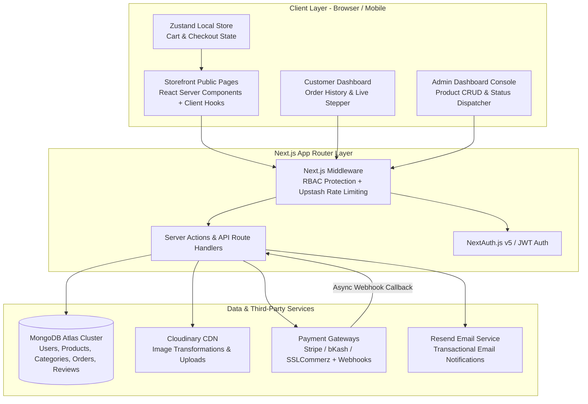
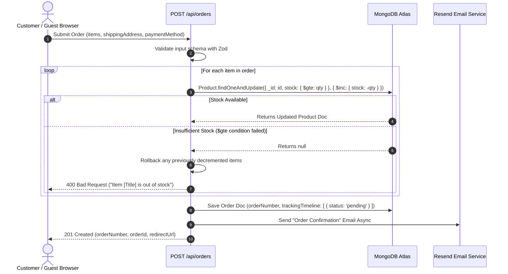
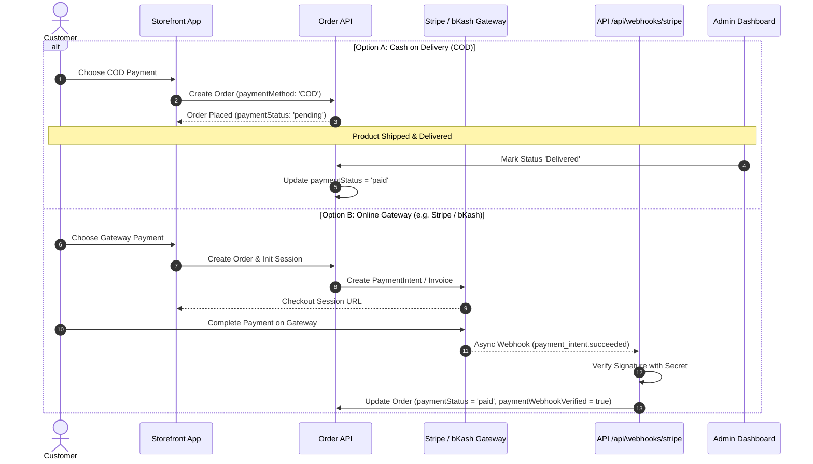
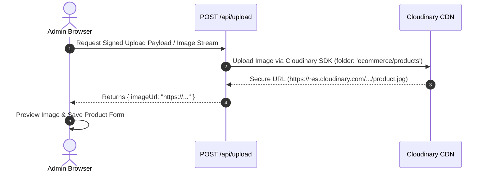

# System Architecture Document

## Project: Modern Full-Stack E-Commerce Platform with Admin & User Portals

> **Document Version**: 1.0.0  
> **Status**: Approved Architecture Blueprint  
> **Based On**: PRD v1.0.0 & PRD Analysis Report  
> **Target Stack**: Next.js 14+ (App Router), TypeScript, MongoDB Atlas (Mongoose), NextAuth.js v5, Tailwind CSS, Cloudinary, Resend

---

## 1. Executive Architecture Overview

This document defines the technical architecture for the **Modern E-Commerce Platform**. It addresses and resolves all **16 issues** identified in the `prd-analysis.md` report, introducing strict type definitions, atomic concurrency controls, full payment lifecycle state machines, normalized database schemas, and robust API specifications.

### Key Architectural Resolutions Implemented:
- **Cloudinary Integration** selected as the standardized media pipeline (§6.4, §10).
- **Atomic Stock Guard** using MongoDB `$inc` and `$gte` conditions to prevent concurrency overselling (§6.1).
- **Payment Lifecycle & Webhooks** support for both COD and Online Gateways (bKash / SSLCommerz / Stripe) (§6.2).
- **Guest & Customer Checkout** supported by making `user` optional in Order schema (§4.5).
- **Normalized Category & Review Collections** added to resolve plain-string category & missing rating data sources (§4.2, §4.4).
- **Multiple Address Book** supported via `addresses: IAddress[]` in User schema (§4.1).

---

## 2. High-Level System Architecture



---

## 3. Directory & File Structure (Next.js 14+ App Router)

```
revise-ecommerce/
├── public/
│   ├── favicon.ico
│   └── images/
├── src/
│   ├── app/
│   │   ├── (auth)/
│   │   │   ├── login/page.tsx
│   │   │   └── register/page.tsx
│   │   ├── (storefront)/
│   │   │   ├── layout.tsx
│   │   │   ├── page.tsx                  # Homepage with Hero, Featured & Catalog
│   │   │   ├── products/
│   │   │   │   ├── page.tsx              # Catalog listing with search & filters
│   │   │   │   └── [slug]/page.tsx       # PDP Product Details Page
│   │   │   ├── cart/page.tsx             # Dedicated Cart view
│   │   │   └── checkout/page.tsx         # Checkout Page (Guest & Customer)
│   │   ├── dashboard/                     # Customer Protected Portal
│   │   │   ├── layout.tsx
│   │   │   ├── page.tsx                  # Overview & Profile
│   │   │   ├── orders/
│   │   │   │   ├── page.tsx              # Order History
│   │   │   │   └── [id]/page.tsx         # Order Details & Tracking Stepper
│   │   │   └── addresses/page.tsx        # Saved Address Book
│   │   ├── admin/                        # Admin Protected Portal (role === 'admin')
│   │   │   ├── layout.tsx
│   │   │   ├── page.tsx                  # Metrics & Overview
│   │   │   ├── products/
│   │   │   │   ├── page.tsx              # Product Table & Stock Badges
│   │   │   │   ├── create/page.tsx       # Product Form
│   │   │   │   └── [id]/edit/page.tsx
│   │   │   ├── categories/page.tsx       # Category CRUD
│   │   │   └── orders/
│   │   │       ├── page.tsx              # Order Management List
│   │   │       └── [id]/page.tsx         # Status Dispatcher & Line Items
│   │   └── api/                          # Route Handlers
│   │       ├── auth/[...nextauth]/route.ts
│   │       ├── products/
│   │       │   ├── route.ts              # GET (List + Search), POST (Admin)
│   │       │   └── [id]/
│   │       │       ├── route.ts          # GET, PUT, DELETE
│   │       │       └── reviews/route.ts   # GET, POST Reviews
│   │       ├── categories/route.ts       # GET, POST (Admin)
│   │       ├── orders/
│   │       │   ├── route.ts              # POST (Create Order)
│   │       │   ├── my-orders/route.ts    # GET Customer Orders
│   │       │   └── [id]/
│   │       │       ├── route.ts          # GET Order details
│   │       │       ├── cancel/route.ts   # POST Cancel Order
│   │       │       └── status/route.ts   # PATCH Admin Status Dispatcher
│   │       ├── webhooks/
│   │       │   └── stripe/route.ts       # Payment Webhook Handler
│   │       └── upload/route.ts           # Cloudinary Upload Endpoint
│   ├── components/
│   │   ├── ui/                           # Reusable UI Atoms (Button, Input, Modal, Badge, Stepper)
│   │   ├── storefront/                   # Storefront components (ProductCard, SearchBar, CartDrawer)
│   │   ├── admin/                        # Admin components (MetricCard, OrderStatusModal, ProductForm)
│   │   └── shared/                       # Navbar, Footer, Providers
│   ├── lib/
│   │   ├── db.ts                         # Mongoose Atlas Connection Singleton
│   │   ├── auth.ts                       # NextAuth options & RBAC helpers
│   │   ├── cloudinary.ts                 # Cloudinary client SDK setup
│   │   ├── email.ts                      # Resend email templates & sender
│   │   ├── ratelimit.ts                  # Upstash Rate Limiter instance
│   │   └── utils.ts                      # Formatter, currency, slugify helpers
│   ├── models/                           # Mongoose Schemas & TypeScript Models
│   │   ├── User.ts
│   │   ├── Category.ts
│   │   ├── Product.ts
│   │   ├── Review.ts
│   │   └── Order.ts
│   ├── store/
│   │   └── useCartStore.ts               # Zustand Cart state manager
│   ├── types/
│   │   └── index.ts                      # Shared TypeScript interfaces
│   └── middleware.ts                     # Edge RBAC & Protection middleware
├── prd.md
├── prd-analysis.md
├── architecture.md
├── package.json
└── tsconfig.json
```

---

## 4. Refined Database Schemas (MongoDB Atlas & Mongoose)

### 4.1 Users Collection (`users`)
```typescript
import { Schema, model, models, Document, Types } from 'mongoose';

export interface IAddress {
  _id?: Types.ObjectId;
  label: string; // e.g. "Home", "Work"
  fullName: string;
  phone: string;
  street: string;
  city: string;
  postalCode: string;
  country: string;
  isDefault: boolean;
}

export interface IUser extends Document {
  name: string;
  email: string;
  passwordHash?: string; // Optional if using OAuth providers
  role: 'user' | 'admin';
  phone?: string;
  addresses: IAddress[]; // Fixed: Multiple saved addresses support
  createdAt: Date;
  updatedAt: Date;
}

const AddressSchema = new Schema<IAddress>({
  label: { type: String, required: true, default: 'Home' },
  fullName: { type: String, required: true },
  phone: { type: String, required: true },
  street: { type: String, required: true },
  city: { type: String, required: true },
  postalCode: { type: String, required: true },
  country: { type: String, required: true, default: 'Bangladesh' },
  isDefault: { type: Boolean, default: false }
});

const UserSchema = new Schema<IUser>({
  name: { type: String, required: true },
  email: { type: String, required: true, unique: true, index: true },
  passwordHash: { type: String },
  role: { type: String, enum: ['user', 'admin'], default: 'user', index: true },
  phone: { type: String },
  addresses: [AddressSchema]
}, { timestamps: true });

export const User = models.User || model<IUser>('User', UserSchema);
```

### 4.2 Categories Collection (`categories`)
```typescript
export interface ICategory extends Document {
  name: string;
  slug: string;
  description?: string;
  icon?: string;
  createdAt: Date;
  updatedAt: Date;
}

const CategorySchema = new Schema<ICategory>({
  name: { type: String, required: true, unique: true },
  slug: { type: String, required: true, unique: true, index: true },
  description: { type: String },
  icon: { type: String }
}, { timestamps: true });

export const Category = models.Category || model<ICategory>('Category', CategorySchema);
```

### 4.3 Products Collection (`products`)
```typescript
export interface IProduct extends Document {
  title: string;
  slug: string;
  description: string;
  category: Types.ObjectId; // Refers to Category collection
  price: number;
  discountPrice?: number;
  stock: number;
  lowStockThreshold: number; // Configurable stock alert per product
  images: string[];
  avgRating: number;        // Aggregated rating cache
  reviewCount: number;      // Total approved reviews count
  isFeatured: boolean;
  status: 'active' | 'draft' | 'archived';
  createdAt: Date;
  updatedAt: Date;
}

const ProductSchema = new Schema<IProduct>({
  title: { type: String, required: true, index: true },
  slug: { type: String, required: true, unique: true, index: true },
  description: { type: String, required: true },
  category: { type: Schema.Types.ObjectId, ref: 'Category', required: true, index: true },
  price: { type: Number, required: true, min: 0 },
  discountPrice: { type: Number, min: 0 },
  stock: { type: Number, required: true, min: 0, default: 0 },
  lowStockThreshold: { type: Number, required: true, default: 5 },
  images: [{ type: String, required: true }],
  avgRating: { type: Number, default: 0, min: 0, max: 5 },
  reviewCount: { type: Number, default: 0, min: 0 },
  isFeatured: { type: Boolean, default: false, index: true },
  status: { type: String, enum: ['active', 'draft', 'archived'], default: 'active', index: true }
}, { timestamps: true });

// Text Index for server-side search
ProductSchema.index({ title: 'text', description: 'text' });

export const Product = models.Product || model<IProduct>('Product', ProductSchema);
```

### 4.4 Reviews Collection (`reviews`)
```typescript
export interface IReview extends Document {
  product: Types.ObjectId;
  user: Types.ObjectId;
  userName: string;
  rating: number; // 1 to 5
  comment: string;
  createdAt: Date;
  updatedAt: Date;
}

const ReviewSchema = new Schema<IReview>({
  product: { type: Schema.Types.ObjectId, ref: 'Product', required: true, index: true },
  user: { type: Schema.Types.ObjectId, ref: 'User', required: true },
  userName: { type: String, required: true },
  rating: { type: Number, required: true, min: 1, max: 5 },
  comment: { type: String, required: true }
}, { timestamps: true });

export const Review = models.Review || model<IReview>('Review', ReviewSchema);
```

### 4.5 Orders Collection (`orders`)
```typescript
export interface IOrderItem {
  product: Types.ObjectId;
  title: string;
  image: string;
  price: number;
  quantity: number;
}

export interface ITrackingEvent {
  status: 'pending' | 'confirmed' | 'processing' | 'shipped' | 'out_for_delivery' | 'delivered' | 'cancelled';
  note?: string;
  updatedAt: Date;
}

export interface IOrder extends Document {
  orderNumber: string;
  user?: Types.ObjectId; // Optional: Allows Guest Checkout
  guestEmail?: string;   // Captured if user is guest
  items: IOrderItem[];
  shippingAddress: {
    fullName: string;
    phone: string;
    street: string;
    city: string;
    postalCode: string;
    country: string;
  };
  paymentMethod: 'COD' | 'bKash' | 'Nagad' | 'SSLCommerz' | 'Stripe';
  paymentStatus: 'pending' | 'paid' | 'failed';
  paymentGatewayRef?: string;       // Webhook/Gateway Transaction ID
  paymentWebhookVerified: boolean;
  subtotal: number;
  shippingFee: number;
  totalAmount: number;
  currentStatus: 'pending' | 'confirmed' | 'processing' | 'shipped' | 'out_for_delivery' | 'delivered' | 'cancelled';
  cancellationReason?: string;
  cancelledBy?: 'customer' | 'admin';
  cancelledAt?: Date;
  trackingTimeline: ITrackingEvent[];
  createdAt: Date;
  updatedAt: Date;
}

const OrderSchema = new Schema<IOrder>({
  orderNumber: { type: String, required: true, unique: true, index: true },
  user: { type: Schema.Types.ObjectId, ref: 'User', index: true }, // Optional for guest checkout
  guestEmail: { type: String },
  items: [{
    product: { type: Schema.Types.ObjectId, ref: 'Product', required: true },
    title: { type: String, required: true },
    image: { type: String, required: true },
    price: { type: Number, required: true },
    quantity: { type: Number, required: true, min: 1 }
  }],
  shippingAddress: {
    fullName: { type: String, required: true },
    phone: { type: String, required: true },
    street: { type: String, required: true },
    city: { type: String, required: true },
    postalCode: { type: String, required: true },
    country: { type: String, required: true, default: 'Bangladesh' }
  },
  paymentMethod: { type: String, enum: ['COD', 'bKash', 'Nagad', 'SSLCommerz', 'Stripe'], required: true },
  paymentStatus: { type: String, enum: ['pending', 'paid', 'failed'], default: 'pending', index: true },
  paymentGatewayRef: { type: String },
  paymentWebhookVerified: { type: Boolean, default: false },
  subtotal: { type: Number, required: true },
  shippingFee: { type: Number, required: true, default: 0 },
  totalAmount: { type: Number, required: true },
  currentStatus: {
    type: String,
    enum: ['pending', 'confirmed', 'processing', 'shipped', 'out_for_delivery', 'delivered', 'cancelled'],
    default: 'pending',
    index: true
  },
  cancellationReason: { type: String },
  cancelledBy: { type: String, enum: ['customer', 'admin'] },
  cancelledAt: { type: Date },
  trackingTimeline: [{
    status: { type: String, required: true },
    note: { type: String },
    updatedAt: { type: Date, default: Date.now }
  }]
}, { timestamps: true });

export const Order = models.Order || model<IOrder>('Order', OrderSchema);
```

---

## 5. Authentication & RBAC Middleware Flow

Next.js `src/middleware.ts` enforces Role-Based Access Control (RBAC) at the edge before any route handler executes:

```typescript
// Role Permission Matrix
// -------------------------------------------------------------
// Route Pattern     | Guest        | Customer      | Admin
// ------------------|--------------|---------------|-----------
// /                 | Allow        | Allow         | Allow
// /products/*       | Allow        | Allow         | Allow
// /cart, /checkout  | Allow (Guest)| Allow         | Allow
// /dashboard/*      | Redirect /   | Allow         | Allow
// /admin/*          | Redirect /   | Redirect /    | Allow
// /api/admin/*      | 401 Unauth   | 403 Forbidden | Allow
// /api/orders       | Allow        | Allow         | Allow
```

---

## 6. Core Operational Sequence Diagrams

### 6.1 Order Creation with Atomic Stock Concurrency Guard

Prevents overselling when multiple customers attempt to purchase the last remaining stock item simultaneously.



---

### 6.2 Payment Lifecycle Sequence (COD vs Online Gateway)



---

### 6.3 Cloudinary Media Upload Pipeline



---

## 7. API Gateway & Route Hierarchy Specifications

| Route Endpoint | Method | Access Level | Query Parameters | Description & Response |
| :--- | :---: | :--- | :--- | :--- |
| `/api/auth/register` | `POST` | Public | None | Create new user account |
| `/api/auth/login` | `POST` | Public | None | Authenticate credentials (NextAuth) |
| `/api/categories` | `GET` | Public | None | List all product categories |
| `/api/categories` | `POST` | Admin | None | Create new product category |
| `/api/products` | `GET` | Public | `page=1`, `limit=20`, `search=`, `category=`, `sort=price_asc\|price_desc\|createdAt_desc` | Paginated product search & filter listing |
| `/api/products/[id]` | `GET` | Public | None | Single product details |
| `/api/products` | `POST` | Admin | None | Create product |
| `/api/products/[id]` | `PUT` | Admin | None | Update product details / stock |
| `/api/products/[id]` | `DELETE` | Admin | None | Soft delete / archive product |
| `/api/products/[id]/reviews` | `GET` | Public | `page=1`, `limit=10` | Retrieve reviews for a product |
| `/api/products/[id]/reviews` | `POST` | Customer | None | Submit product review & update avgRating |
| `/api/orders` | `POST` | Guest / Customer | None | Submit new order (Executes atomic stock guard) |
| `/api/orders/my-orders` | `GET` | Customer | `page=1`, `limit=10` | Retrieve logged-in customer's order history |
| `/api/orders/[id]` | `GET` | Guest / Customer / Admin | None | Retrieve order details & tracking timeline |
| `/api/orders/[id]/cancel` | `POST` | Customer / Admin | None | Cancel order (If status is `pending` or `confirmed`) |
| `/api/admin/metrics` | `GET` | Admin | None | Dashboard stats (total revenue, pending count, low stock list) |
| `/api/admin/orders` | `GET` | Admin | `status=`, `page=1`, `limit=20` | Paginated admin order management |
| `/api/admin/orders/[id]/status` | `PATCH` | Admin | None | Advance order status & push tracking timeline event |
| `/api/webhooks/stripe` | `POST` | Public (Signed) | None | Async payment webhook listener |
| `/api/upload` | `POST` | Admin | None | Cloudinary image upload handler |

---

## 8. State Management Strategy

### 8.1 Client-Side Shopping Cart (`useCartStore.ts`)
Built with **Zustand** and persisted in `localStorage`:

```typescript
import { create } from 'zustand';
import { persist } from 'zustand/middleware';

export interface CartItem {
  productId: string;
  title: string;
  slug: string;
  price: number;
  image: string;
  quantity: number;
  stock: number;
}

interface CartState {
  items: CartItem[];
  addItem: (item: CartItem) => void;
  removeItem: (productId: string) => void;
  updateQuantity: (productId: string, quantity: number) => void;
  clearCart: () => void;
  getSubtotal: () => number;
}

export const useCartStore = create<CartState>()(
  persist(
    (set, get) => ({
      items: [],
      addItem: (newItem) => {
        const currentItems = get().items;
        const existing = currentItems.find(i => i.productId === newItem.productId);
        if (existing) {
          set({
            items: currentItems.map(i =>
              i.productId === newItem.productId
                ? { ...i, quantity: Math.min(i.quantity + newItem.quantity, i.stock) }
                : i
            )
          });
        } else {
          set({ items: [...currentItems, newItem] });
        }
      },
      removeItem: (productId) => set({ items: get().items.filter(i => i.productId !== productId) }),
      updateQuantity: (productId, quantity) => set({
        items: get().items.map(i => i.productId === productId ? { ...i, quantity } : i)
      }),
      clearCart: () => set({ items: [] }),
      getSubtotal: () => get().items.reduce((sum, item) => sum + (item.price * item.quantity), 0)
    }),
    { name: 'ecommerce-cart-storage' }
  )
);
```

### 8.2 Server-Side State & React Server Components (RSC)
- **Storefront Home & Catalog Pages**: Rendered as Next.js Server Components with direct Mongoose queries for zero client JavaScript bundle bloat.
- **Dynamic Customer & Admin Dashboards**: Dynamic server rendering with SWR / TanStack Query for background revalidation.

---

## 9. Security, Rate Limiting & NFR Architecture

### 9.1 Rate Limiting Architecture (Upstash Redis)

| Endpoint Scope | Max Requests | Window | Storage Engine |
| :--- | :--- | :--- | :--- |
| `/api/auth/login`, `/api/auth/register` | 10 requests | 1 minute | Upstash Redis |
| `/api/orders` (Order submission) | 5 requests | 1 minute | Upstash Redis |
| `/api/upload` (Image upload) | 20 requests | 1 hour | Upstash Redis |
| General Public APIs (`/api/products`) | 100 requests | 1 minute | Edge Middleware Memory |

### 9.2 Data Privacy & GDPR Rules
- User passwords hashed using `bcryptjs` with salt rounds = 12.
- User address data encrypted in transit (HTTPS) and at rest (MongoDB Atlas TLS/AES-256).
- Account deletion endpoint (`DELETE /api/user/account`) permanently removes user credentials while retaining anonymized order financial records for compliance.

### 9.3 Performance SLAs & Core Web Vitals
- **LCP (Largest Contentful Paint)**: < 2.0 seconds
- **FID (First Input Delay)**: < 100ms
- **CLS (Cumulative Layout Shift)**: < 0.05
- **API Response Target**: p95 < 250ms
- **Target Availability**: 99.9% Uptime (Vercel Edge Network + MongoDB Atlas Multi-AZ)

---

## 10. Deployment & Environment Configuration

### Required Environment Variables (`.env.local`)

```env
# Node Environment
NODE_ENV=production
NEXT_PUBLIC_APP_URL=https://your-domain.com

# Database Connection (MongoDB Atlas)
MONGODB_URI=mongodb+srv://<username>:<password>@cluster0.mongodb.net/ecommerce?retryWrites=true&w=majority

# NextAuth Authentication
NEXTAUTH_SECRET=your_super_secret_jwt_key_here
NEXTAUTH_URL=https://your-domain.com

# Cloudinary Media Storage (ISSUE-09 Resolution)
NEXT_PUBLIC_CLOUDINARY_CLOUD_NAME=your_cloud_name
CLOUDINARY_API_KEY=your_api_key
CLOUDINARY_API_SECRET=your_api_secret

# Upstash Redis Rate Limiting (ISSUE-NFR-1 Resolution)
UPSTASH_REDIS_REST_URL=https://your-redis.upstash.io
UPSTASH_REDIS_REST_TOKEN=your_upstash_token

# Resend Transactional Email (ISSUE-NFR-4 Resolution)
RESEND_API_KEY=re_123456789_your_resend_key

# Payment Gateway Keys (ISSUE-01-PAY Resolution)
STRIPE_SECRET_KEY=sk_live_123456
STRIPE_WEBHOOK_SECRET=whsec_123456
```

---

## 11. Responsive Design Architecture & Mobile-First Strategy

The platform implements a **Mobile-First Responsive Design Strategy** using Tailwind CSS utility classes, flexible CSS grid/flexbox layouts, and dynamic client-side view adapters to ensure 100% responsiveness across mobile (smartphones), tablet, laptop, and desktop displays.

### 11.1 Breakpoint Tokens & Device Layout System

| Device Class | Viewport Range | Tailwind Prefix | Container & Layout Specs |
| :--- | :--- | :--- | :--- |
| **Mobile Portrait** | `320px` – `639px` | Default (no prefix) | 1-column grid (`grid-cols-1`), Full-width drawers, Bottom sticky action bars, Collapsible hamburger navigation. |
| **Mobile Landscape / Small Tablet** | `640px` – `767px` | `sm:` | 2-column grid (`sm:grid-cols-2`), Inline modal dialogs, 16px horizontal padding. |
| **Tablet Portrait / Laptop** | `768px` – `1023px` | `md:` | 3-column grid (`md:grid-cols-3`), Split-view PDP, Collapsible admin sidebar drawer. |
| **Desktop / Laptop HD** | `1024px` – `1279px` | `lg:` | 4-column grid (`lg:grid-cols-4`), Fixed sticky filter sidebar, Permanent admin sidebar navigation. |
| **Ultra-Wide / 4K Monitor** | `1280px`+ | `xl:`, `2xl:` | Max-width container (`max-w-7xl mx-auto`), 5-column grid (`2xl:grid-cols-5`), Floating cart drawer preview. |

---

### 11.2 Component Responsiveness Matrix

```
┌────────────────────────────────────────────────────────────────────────────────────────┐
│                                COMPONENT RESPONSIVENESS MATRIX                          │
├──────────────────┬────────────────────────────────────┬────────────────────────────────┤
│ Component        │ Mobile / Small Screens (<768px)    │ Desktop / Large Screens (≥1024px)│
├──────────────────┼────────────────────────────────────┼────────────────────────────────┤
│ Main Navigation  │ Slide-over Drawer + Touch Menu     │ Full Top Navbar + Hover Menus  │
│ Product Catalog  │ 1-2 Columns (`grid-cols-1 sm:2`)   │ 4 Columns (`lg:grid-cols-4`)   │
│ PDP Gallery      │ Touch Swipe Carousel + Dots        │ Thumbnail Column + Main Zoom   │
│ Checkout Flow    │ 1 Column + Bottom Sticky Pay Bar   │ 2 Column (Form Left, Cart Right│
│ Order Stepper    │ Vertical Timeline Stepper          │ Horizontal Progress Bar        │
│ Admin Data Table │ Responsive Card List Stack View    │ Full Data Table + Sticky Header│
└──────────────────┴────────────────────────────────────┴────────────────────────────────┘
```

---

### 11.3 Mobile UI/UX & Touch Optimizations

1. **Dynamic Viewport Height (`dvh`)**:
   - Uses `min-h-dvh` instead of `100vh` to eliminate unwanted layout shifts caused by mobile browser URL bar toggles (iOS Safari & Chrome Android).
2. **Touch Target Accessibility**:
   - All interactive buttons, icon triggers, cart quantity adjusters, and form inputs adhere to a minimum touch target size of **`44px × 44px`** (`min-h-[44px] min-w-[44px]`).
3. **Sticky Cart & Checkout Bar for Mobile**:
   ```tsx
   // Mobile sticky bottom CTA component pattern
   <div className="fixed bottom-0 left-0 right-0 z-40 border-t bg-white p-4 shadow-lg lg:hidden">
     <div className="flex items-center justify-between">
       <div>
         <span className="text-xs text-muted-foreground">Total</span>
         <p className="text-lg font-bold">৳{totalAmount}</p>
       </div>
       <Button size="lg" onClick={handleCheckout}>Proceed to Checkout</Button>
     </div>
   </div>
   ```
4. **Admin Mobile Card Fallback**:
   - Data tables on screens `< 768px` automatically collapse into compact card stacks with swipe action triggers so admins can manage orders smoothly on mobile phones without horizontal scrolling pain.

---

*This architecture document forms the complete engineering specification for the Modern E-Commerce Platform project.*

